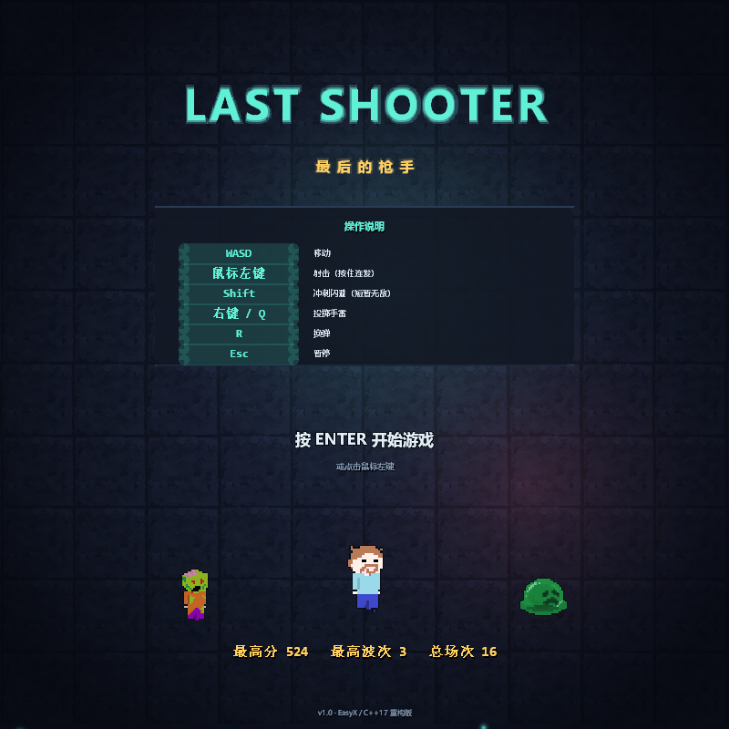

# LAST SHOOTER · 最后的枪手

一个用 **C++17 + EasyX** 写成的俯视角弹幕射击（twin-stick shooter）小游戏。
本仓库是原先那个「一个 main.cpp 打天下」的课程作业级项目（见 `legacy/`）的**彻底重构版**：
保留原美术素材与技术栈，重写为分层架构、固定步长主循环、可无头自测的完整游戏。



---

## 一、怎么玩

| 操作 | 说明 |
| --- | --- |
| `W A S D` / 方向键 | 移动 |
| **鼠标左键（按住）** | 朝准星连续射击 |
| `Shift` | 冲刺闪避，短时间无敌，有冷却 |
| **鼠标右键 / `Q`** | 朝准星方向投掷手雷（爆炸范围内清弹幕） |
| `R` | 换弹（弹匣打空会自动换） |
| `Esc` | 暂停 / 从暂停恢复 |
| `Enter` | 开始游戏、结算后重开 |
| `F5` | 重新开始（调试用） |

核心循环：**清光一波敌人 → 短暂喘息 → 更强的下一波**。
每 5 波会来一只**首领**（血条显示在屏幕上方，会发射环形弹幕并冲撞）。
击杀敌人累积连击（`x1`~`x8` 得分倍率），2.6 秒内没有新击杀则连击归零。

敌人种类：

| 敌人 | 特点 |
| --- | --- |
| 僵尸 | 基础追兵，血量中等 |
| 疾行者 | 高速、带正弦摆动，难预判 |
| 史莱姆 | 死亡后分裂成两只小史莱姆 |
| 喷吐者 | 保持中距离绕圈，三连发远程弹幕 |
| 巨兽 | 高血量、被靠近后发起冲锋 |
| 首领 | 每 5 波出现，环形弹幕 + 冲撞，血厚 |

掉落物（拾取后永久/立即生效）：

| 图标 | 效果 |
| --- | --- |
| 移动速度 + | 移速 +8.5%，最多 5 层 |
| 子弹伤害 + | 每发子弹 +1 伤害，4 层后子弹变粗并可穿透 |
| 射速 + | 射速 +16%，最多 5 层 |
| 生命 + | 生命上限 +1 并回复 1 点（上限 9） |
| 手雷 + | 手雷 +1（上限 5） |

> 血量低于 2 时屏幕边缘会泛红、宠物……不，是心跳式脉冲，提醒你该跑路了。

---

## 二、怎么编译运行

### 依赖

* **MinGW-w64 g++（x64）**：GCC 8 以上即可（本项目在 GCC 13.1 上验证）。
  推荐 [RedPanda C++](https://github.com/royqh1979/RedPanda-CPP) 或 [MSYS2](https://www.msys2.org/) 自带的 MinGW。
* **EasyX 26.x**：已经随仓库放在 `third_party/easyx`（含 MinGW 与 MSVC 两套库），**不需要另外安装**。

### 一条命令

```bat
build.bat            :: 编译 Release 到 build\lastShooter.exe
build.bat run        :: 编译并立刻运行
build.bat debug      :: Debug 构建（带控制台，方便看日志）
```

脚本会自动探测常见的 g++ 路径（RedPanda / Dev-C++ / MSYS2 / PATH）。
如果都不在，手动指定一次即可：

```bat
set LS_GXX=C:\mingw64\bin\g++.exe
build.bat
```

也可以直接用 `src` 下任意 IDE 打开工程，把所有 `src/**/*.cpp` 加进去，包含目录填
`third_party/easyx/include`，链接 `third_party/easyx/lib_mingw_msvcrt/x64/libeasyxw.a`
以及 `winmm gdi32 ole32 uuid msimg32 gdiplus user32 shell32`。

启动后如果提示「找不到 assets」，说明 `assets/` 目录没有被放在 exe 的同层或上层目录
（程序会自动向上找 5 层）。

### 命令行参数

```text
--autoplay        机器人自动演示（不用键盘也能看）
--mute            静音
--selftest[=N]    无头自测：跑 N 帧模拟并打印统计（默认 3000）
--capture=DIR     按脚本把关键画面截图到 DIR 后退出（开发自测用）
--verbose         输出运行日志
```

`--selftest` 会做不变式检查（位置不出界、血量不越界、分数非负、敌人数量上限……），
适合改完逻辑后回归：

```text
[selftest] wave        : 6
[selftest] kills       : 43
[selftest] score       : 1415
[selftest] shots fired : 523
[selftest] hits taken  : 7
SELFTEST OK
```

---

## 三、和原版相比改了什么

原版 `legacy/main.cpp` 是一个 700 行的单文件：全局变量满地、`dangan B` 只能存在一发子弹、
被打到就 `exit(0)`、敌人数量 `N += WAVE/2` 会指数爆炸、鼠标不动就不开火、随机数每次
`srand(clock())`……

重构后：

**架构**

| 层 | 目录 | 职责 |
| --- | --- | --- |
| 核心 | `src/core` | 数学（`Vec2`/插值/形状）、确定性随机、输入快照、日志 |
| 渲染 | `src/gfx` | `Sprite`（像素图元：抠图/缩放/旋转/镜像/染色/描边）、`Canvas`（自写 alpha/加法混合器）、粒子系统、资源仓库 |
| 音频 | `src/audio` | MCI 多通道播放 + **启动时程序化合成**全部音效（不需要音频素材） |
| UI | `src/ui` | 文字（GDI，带中文）与「文字蒙版」霓虹字 |
| 玩法 | `src/game` | `World`（纯模拟）、`Player`/`Enemy`/`Bullet`/`Pickup`/`Grenade`、`WaveDirector`（预算制波次）、`Hud`、`Game`（状态机 + 主循环）、存档 |

**玩法**

* 固定步长 60Hz 模拟与渲染解耦（`accumulator`），窗口掉帧不会让物理变慢；单帧最多补 4 步避免死亡螺旋。
* 子弹对象池，支持穿透、枪口火花、拖尾；敌人弹幕独立管理。
* 5 种敌人 + 首领，各有独立行为（保持距离、冲锋、分裂、环形弹幕……）。
* 预算制波次导演：按「造价」组阵容，难度平滑上升，不会再数量爆炸。
* 连击得分倍率、暴击式飘字、掉落自适应（残血更容易掉红心）。
* 换弹 / 手雷 / 冲刺无敌帧 / 受击击退 / 拾取磁吸。
* 标题、暂停、结算三套界面，最高分本地持久化。

**手感与表现**

* 纯 CPU 像素混合器：alpha 混合 + **加法混合**（所有发光效果）、裁剪、暗角、去色。
* 屏幕震动（trauma 模型）、命中停顿（hitstop）、死亡慢镜头、受击红闪、低血量脉冲。
* 粒子：火花、碎片、冲击波、拖尾、爆炸。敌人被击中有白闪，出生有能量拖影。
* 敌人贴图统一加**暗描边**——16bit 像素画压在噪点砖墙上不加描边会糊成一片。
* 所有文字走「渲染成蒙版 → 用混合器绘制」的管线，于是霓虹发光、淡入淡出、缩放都能用。
* 战场内缩，HUD 永远不会挡住可玩区域；边框 + 四角括号明确边界。

**工程**

* `assets/` 与 `src/` 分离；旧代码整体归档到 `legacy/` 以作对照。
* 无第三方构建系统依赖：`build.bat` 一条命令完成，EasyX 随仓库分发。
* `--selftest` 可无头回归，`--capture` 可自动出图（本次重构的美术调整就是靠它逐屏核对的）。

---

## 四、目录结构

```text
lastShooter/
├─ build.bat                 # 一键构建（自动找 g++）
├─ src/
│  ├─ main.cpp               # 入口（同时提供 main / WinMain）
│  ├─ core/                  # Math / Random / Input / Log
│  ├─ gfx/                   # Color / Sprite / Canvas / Particles / Assets
│  ├─ audio/                 # Audio（MCI + 合成音效）
│  ├─ ui/                    # Text（含霓虹字蒙版）
│  └─ game/                  # Config / Player / Enemy / Bullet / Pickup / Grenade
│                            # World / Wave / Hud / Save / Game
├─ assets/
│  ├─ image/*.png            # 原版美术素材（英雄、僵尸、史莱姆、道具……）
│  ├─ audio/shoot.mp3        # 原版音效（重构后音效改为合成，素材保留作纪念）
│  └─ icon.ico
├─ third_party/easyx/        # EasyX 头文件与库（MinGW + MSVC）
├─ docs/screenshots/         # 截图
└─ legacy/                   # 重构前的原始代码（只作对照，不参与编译）
```

## 五、想改手感？

所有数值都在 `src/game/Config.h` 里，一处改完重新编译即可：

```cpp
constexpr float kPlayerMaxSpeed = 240.0f;   // 移速
constexpr int   kMagazineSize   = 18;       // 弹匣容量
constexpr float kFireInterval   = 0.115f;   // 射击间隔（秒）
constexpr float kComboWindow    = 2.6f;     // 连击窗口
constexpr int   kBossEveryNWaves = 5;       // 每几波一个首领
```

敌人属性表在 `src/game/Enemy.cpp` 顶部的 `kStats[]`（血量 / 速度 / 半径 / 接触伤害 / 分数 / 造价）。
波次阵容与节奏在 `src/game/Wave.cpp`。

---

## 六、致谢与许可

美术素材、原始玩法构想来自原仓库 `Jipai1716/game_lastShooter`；重构部分由本次重写完成。
EasyX 版权归其作者所有（见 `third_party/easyx`）。本项目仅用于学习交流。
